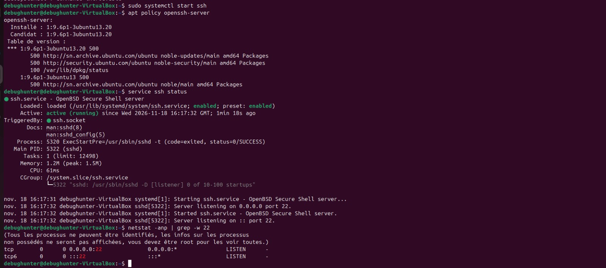
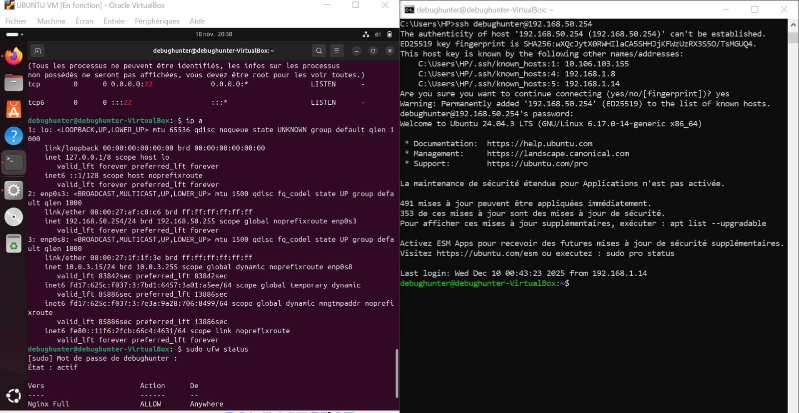
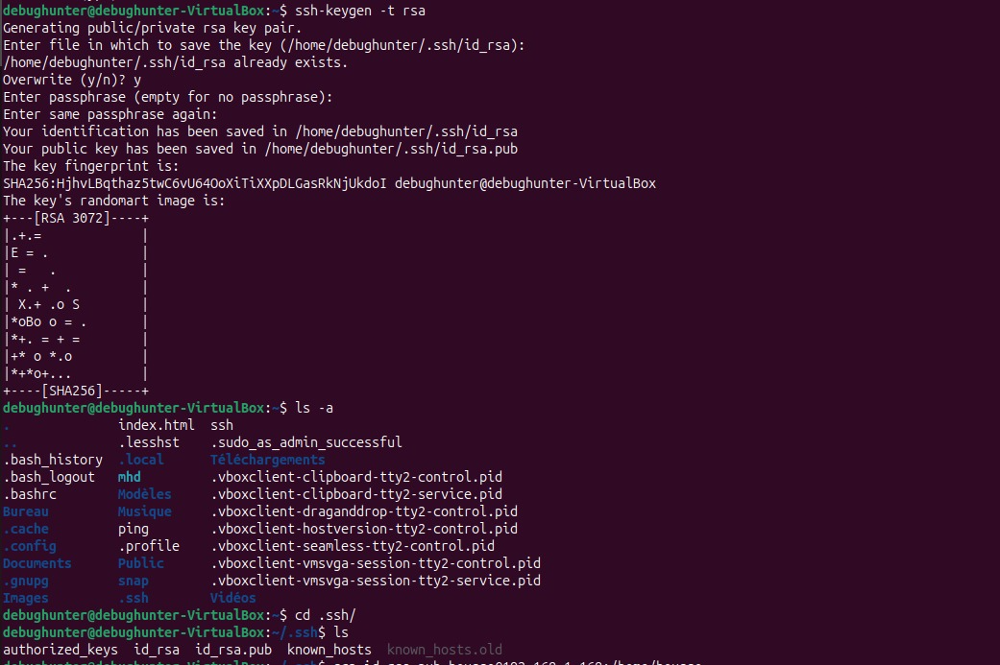
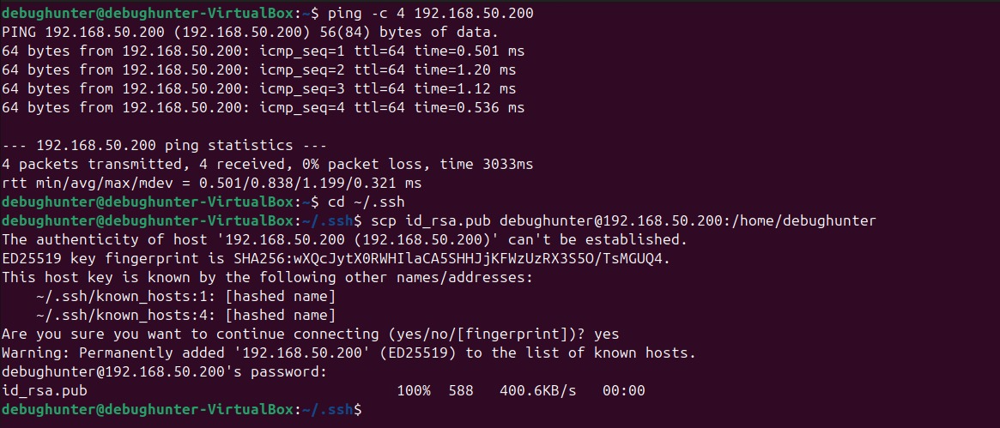
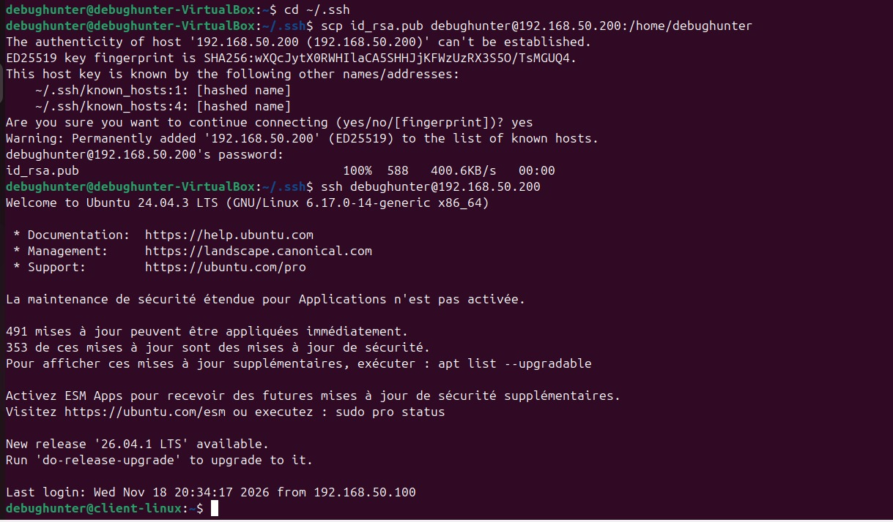
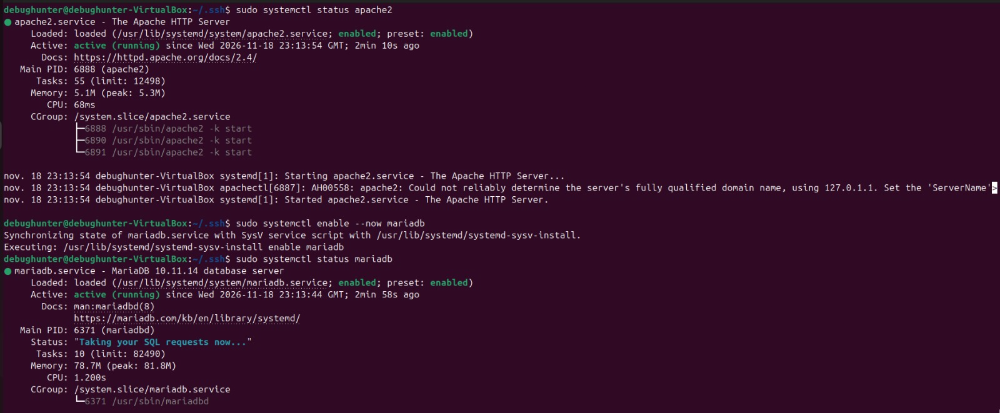
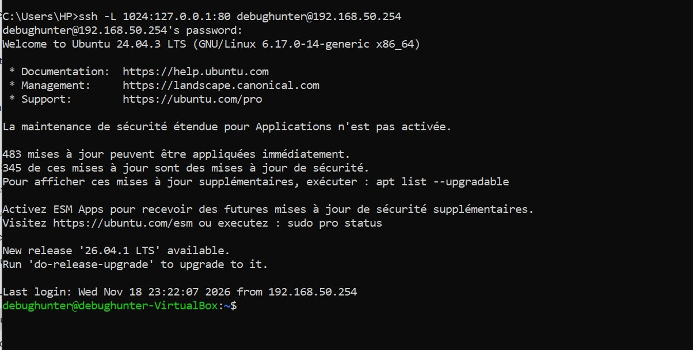
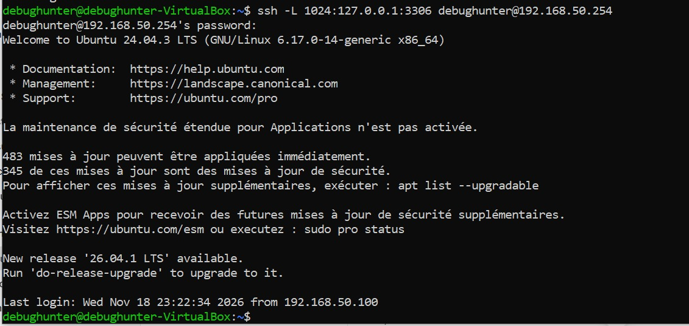
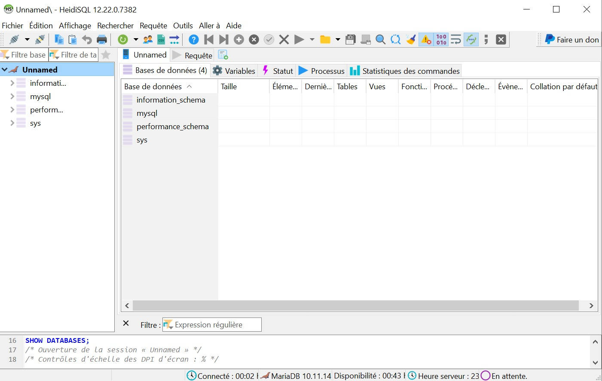
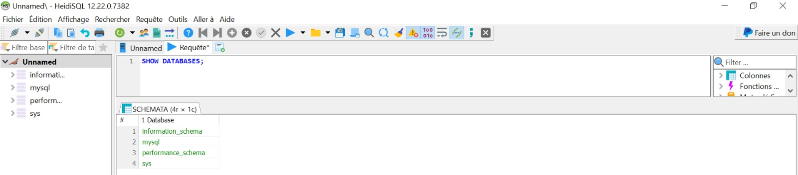

# TP : Mise en place du protocole SSH

- Nom et prénom : Mohamed Aboubacar Aw et Mamadou Dia
- Classe : L3 GLSIA, DGI-ESP / UCAD 2026-2027
- Module : Services Réseaux Avancés
- Enseignant : Dr. GUEYE
- Date : 19 novembre 2026

## Note préliminaire : organisation du travail en binôme

Ce TP est prévu pour être réalisé en binôme, avec des machines reliées entre elles sur un même réseau. Les deux membres du binôme, Mohamed Aboubacar Aw et Mamadou Dia, n'habitent pas ensemble et ne sont donc pas sur le même réseau local : il n'était pas possible de connecter nos machines l'une à l'autre.

Nous avons donc procédé de la manière suivante :

- Chacun a réalisé l'ensemble du TP de son côté, sur son propre environnement (une machine virtuelle Ubuntu et un poste Windows), en exécutant lui-même toutes les commandes et tous les tests demandés.
- Nous avons travaillé en même temps, en visioconférence sur Meet. Lorsque l'un de nous rencontrait une difficulté, l'autre l'aidait à la résoudre, et nous avons comparé nos résultats à chaque étape.
- Pour remplacer la seconde machine Linux, chacun a cloné sa machine virtuelle et l'a utilisée comme client Linux.
- Les captures d'écran et les adresses IP présentées dans ce rapport proviennent de l'environnement de Mohamed Aboubacar Aw. Les adresses de Mamadou Dia sont différentes, mais les étapes, les commandes et les résultats sont identiques.

## 1. Objectif

Comprendre comment utiliser SSH pour sécuriser l'accès à une machine distante : installation du serveur, connexion d'un client, authentification par clés et tunnel SSH.

## 2. Environnement de travail

| Machine | Système | Adresse IP | Utilisateur |
|---|---|---|---|
| Serveur SSH (VM VirtualBox) | Ubuntu 24.04.3 LTS | 192.168.50.254 | debughunter |
| Client Windows (PC physique) | Windows | 192.168.50.100 | HP |
| Client Linux (clone de la VM) | Ubuntu 24.04.3 LTS | 192.168.50.200 | debughunter |

Remarque : n'ayant pas de seconde machine Linux, le client Linux est un clone de la VM serveur (nouvelle adresse MAC, nouvelle adresse IP, nom d'hôte client-linux).

## 3. Étape 1 : Installation de SSH

Installation du serveur OpenSSH sur la machine Linux (serveur) :

```bash
sudo apt update
sudo apt install openssh-server
sudo systemctl enable ssh
sudo systemctl start ssh
```

Vérifications effectuées :

```bash
apt policy openssh-server
service ssh status
netstat -anp | grep -w 22
```



*Figure 1 : Installation et vérification du serveur OpenSSH. Le paquet openssh-server est installé (version 9.6p1), le service ssh est actif et activé au démarrage, et le port 22 est en écoute (LISTEN) en IPv4 et IPv6.*

## 4. Étape 2 : Connexion SSH depuis le client

L'adresse IP du serveur est relevée avec la commande ip a (interface enp0s3 : 192.168.50.254). Depuis le client Windows, la connexion se fait avec :

```bash
ssh debughunter@192.168.50.254
```

À la première connexion, l'empreinte de l'hôte est acceptée (yes), puis le mot de passe de l'utilisateur est saisi.



*Figure 2 : À gauche, adresse IP du serveur (ip a). À droite, connexion du client Windows au serveur SSH : le prompt debughunter@debughunter-VirtualBox s'affiche.*

## 5. Étape 3 : Configuration des clés SSH

### 5.1 Génération de la paire de clés sur le serveur

```bash
ssh-keygen -t rsa
ls -a
cd .ssh/
ls
```

La paire de clés est créée dans /home/debughunter/.ssh : id_rsa (clé privée) et id_rsa.pub (clé publique). Le dossier .ssh est visible avec ls -a.



*Figure 3 : Génération de la paire de clés RSA 3072 bits, vérification du dossier .ssh et de son contenu (id_rsa et id_rsa.pub).*

### 5.2 Copie de la clé publique du serveur vers le client Linux

```bash
ping -c 4 192.168.50.200
cd ~/.ssh
scp id_rsa.pub debughunter@192.168.50.200:/home/debughunter
```

Le client Linux (192.168.50.200) répond au ping, puis la clé publique est envoyée dans son répertoire /home. Le mot de passe n'est demandé qu'une seule fois, pour le scp.



*Figure 4 : Test de connectivité (0 % de perte) puis envoi de id_rsa.pub vers le client Linux (transfert à 100 %).*

### 5.3 Test de connexion sans mot de passe

```bash
ssh debughunter@192.168.50.200
```



*Figure 5 : Connexion du serveur au client Linux sans saisie de mot de passe. Le prompt devient debughunter@client-linux.*

Vérification de la présence de la clé publique sur le client :

```bash
ls ~
```


*Figure 6 : Le fichier id_rsa.pub est présent dans le répertoire home du client Linux.*

## 6. Étape 4 : Tunnel SSH en ligne de commande

Le principe est d'établir un tunnel SSH entre un client et un serveur afin de faire transiter un autre protocole (HTTP, MySQL, FTP...) à travers le port SSH. Les services de test sont installés sur le serveur :

```bash
sudo apt install apache2 mariadb-server
sudo systemctl status apache2
sudo systemctl enable --now mariadb
sudo systemctl status mariadb
```



*Figure 7 : Les services Apache2 et MariaDB 10.11.14 sont actifs (active (running)) sur le serveur.*

### 6.1 Tunnel vers le serveur web

Le port local 1024 du client est relié au port 80 du serveur :

```bash
ssh -L 1024:127.0.0.1:80 debughunter@192.168.50.254
```



*Figure 8 : Création du tunnel SSH (port local 1024 vers le port 80 du serveur).*

Le navigateur du client accède à la page web du serveur via l'adresse http://127.0.0.1:1024.


*Figure 9 : La page web du serveur est affichée dans le navigateur via le tunnel (127.0.0.1:1024).*

### 6.2 Tunnel vers la base de données

Le port local 1024 est cette fois relié au port 3306 (MariaDB) du serveur. Un utilisateur testuser a été créé dans MariaDB pour le test :

```bash
sudo mariadb
CREATE USER 'testuser'@'localhost' IDENTIFIED BY '********';
GRANT ALL PRIVILEGES ON *.* TO 'testuser'@'localhost';
FLUSH PRIVILEGES;
```

```bash
ssh -L 1024:127.0.0.1:3306 debughunter@192.168.50.254
```



*Figure 10 : Création du tunnel SSH (port local 1024 vers le port 3306 de MariaDB).*

Le client Windows utilise HeidiSQL avec les paramètres : hôte 127.0.0.1, utilisateur testuser, port 1024.



*Figure 11 : HeidiSQL connecté à MariaDB 10.11.14 à travers le tunnel SSH. Les 4 bases de données du serveur sont listées.*



*Figure 12 : Exécution de la requête SHOW DATABASES; depuis HeidiSQL. Le résultat confirme l'accès à la base de données distante par le tunnel.*

## 7. Conclusion

Ce TP a permis d'installer et de vérifier un serveur SSH, de s'y connecter depuis un client Windows, de mettre en place l'authentification par clés entre deux machines Linux, et de créer des tunnels SSH pour accéder à un serveur web et à une base de données MariaDB à travers le port 22.
